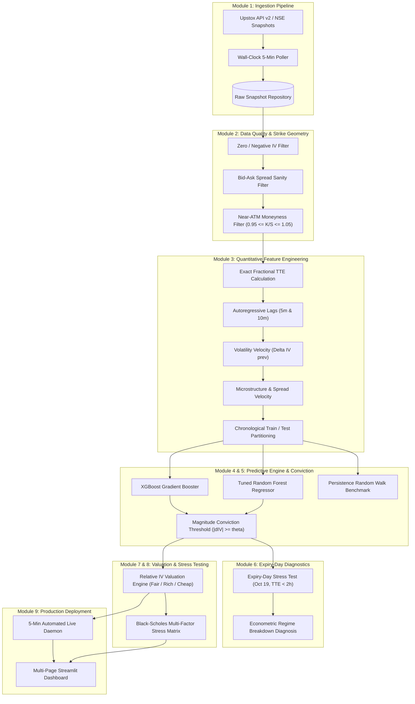
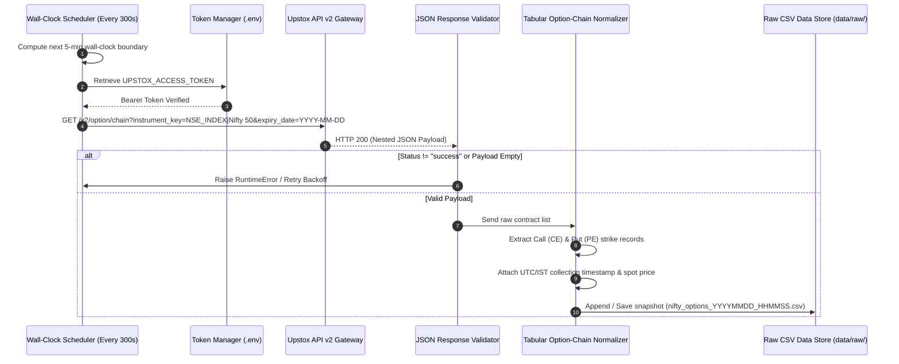
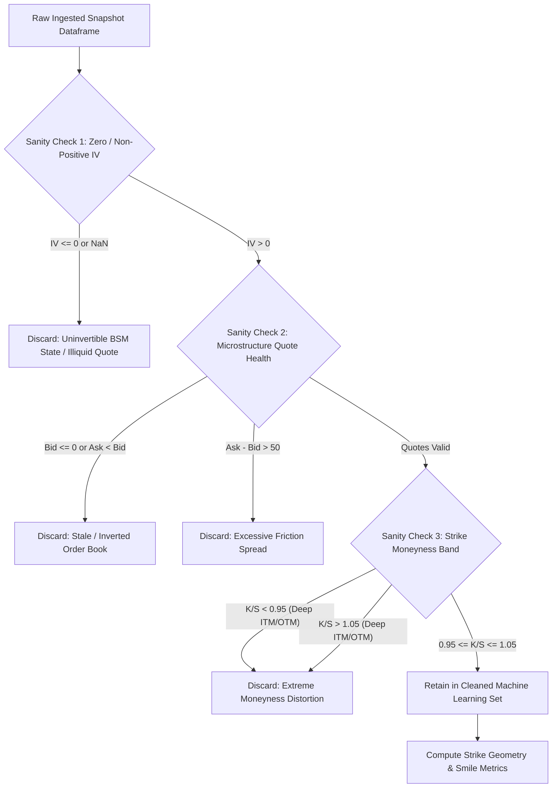
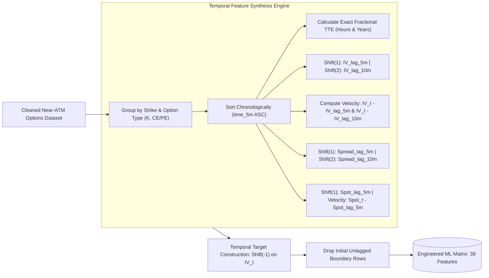
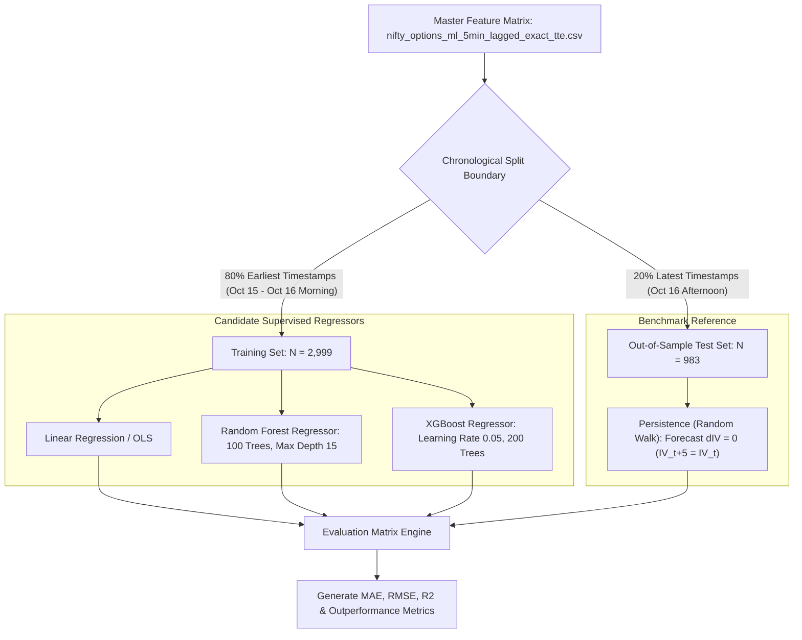
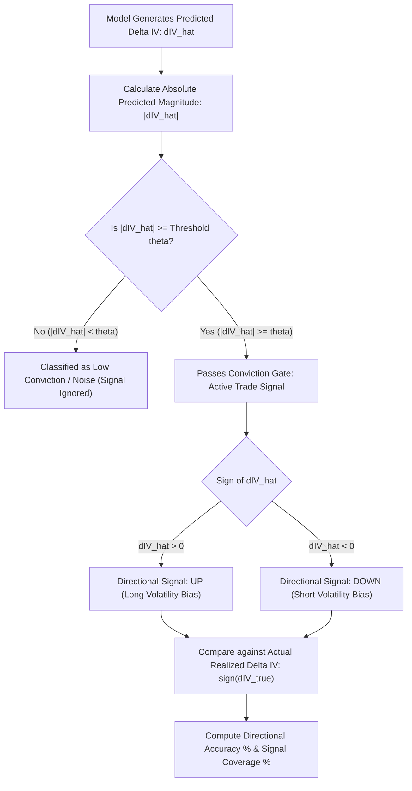
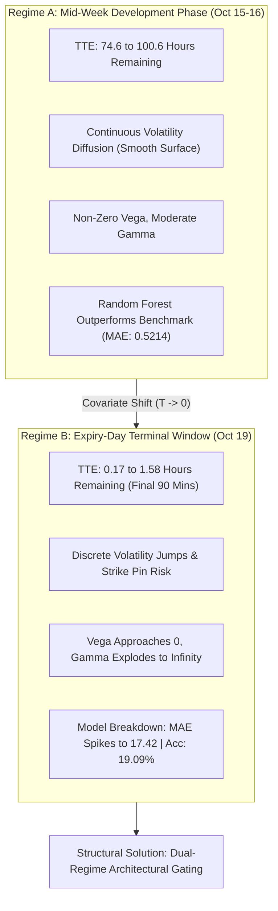
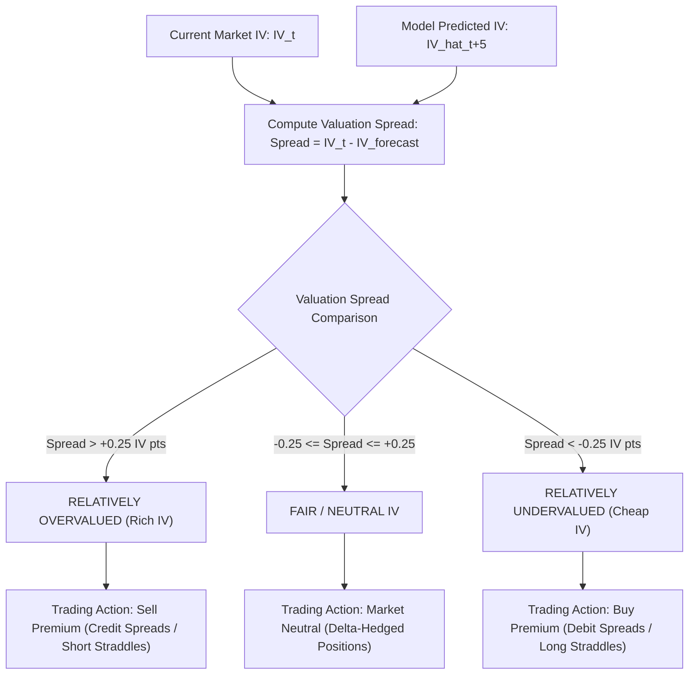
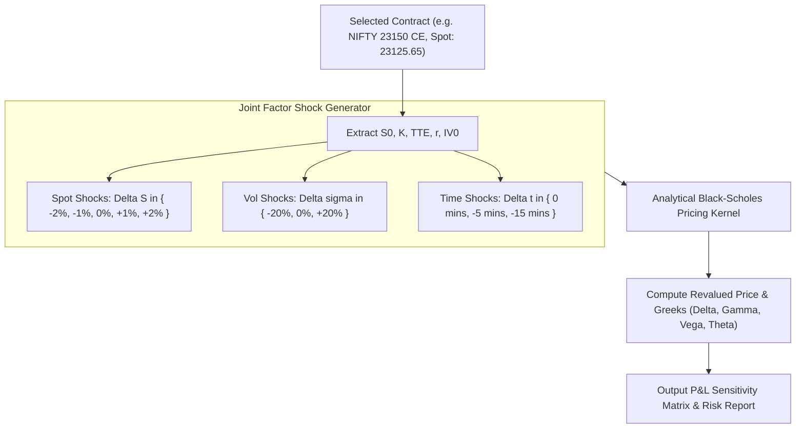
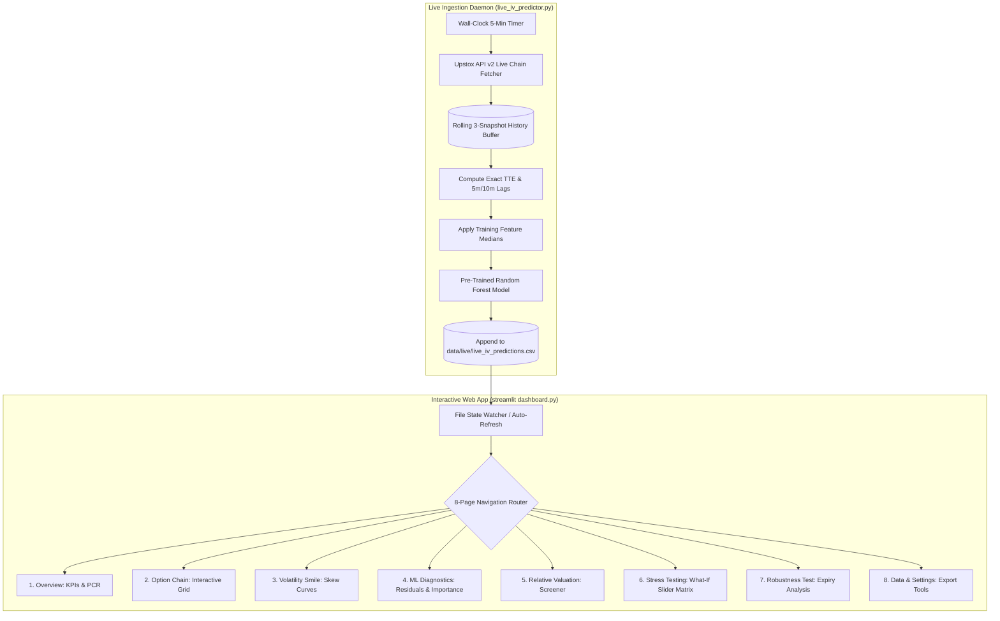

# 🏛️ End-to-End System Pipeline, Quantitative Logic & Architectural Specification

> **Project Title:** Machine-Learning-Driven Implied Volatility Forecasting & Relative Option Valuation  
> **Target Asset:** National Stock Exchange of India (NSE) — NIFTY 50 Index Weekly Options  
> **Author:** Diviya C. (M.Sc. Quantitative Finance, Pondicherry University, Reg. No: `25MSQUFPY0018`)  
> **Institutional Host:** Surabhi Investment Services Pvt. Ltd., Tiruchirappalli, Tamil Nadu  
> **Document Purpose:** Exhaustive Technical Architecture, Algorithmic Logic, Mathematical Formulations, and Mermaid Pipeline Flowcharts for all Research Steps (Steps 1–25), Production Streaming Daemons, and Institutional Analytics Interfaces.

---

## 📑 Master Architecture Navigation

- [Executive Pipeline Overview & System Taxonomy](#-executive-pipeline-overview--system-taxonomy)
- [Module 1: Ingestion & API Collection Pipeline (Steps 1–4, 15)](#-module-1-ingestion--api-collection-pipeline-steps-14-15)
- [Module 2: Quality Control, Hygiene & Strike Geometry Filtering (Steps 5–8, 16)](#-module-2-quality-control-hygiene--strike-geometry-filtering-steps-58-16)
- [Module 3: Quantitative Preprocessing & Temporal Feature Engineering (Steps 11, 16, 19)](#-module-3-quantitative-preprocessing--temporal-feature-engineering-steps-11-16-19)
- [Module 4: Machine Learning Model Development & Empirical Benchmarking (Steps 9–10, 12–13)](#-module-4-machine-learning-model-development--empirical-benchmarking-steps-910-1213)
- [Module 5: Conviction Thresholding & Directional Classification Engine (Steps 14, 21)](#-module-5-conviction-thresholding--directional-classification-engine-steps-14-21)
- [Module 6: Expiry-Day Structural Regime Shift Analysis (Steps 17–18)](#-module-6-expiry-day-structural-regime-shift-analysis-steps-1718)
- [Module 7: Relative IV Valuation & Systematic Alpha Generation (Step 20)](#-module-7-relative-iv-valuation--systematic-alpha-generation-step-20)
- [Module 8: Multi-Factor Black-Scholes Scenario Stress Testing (Step 22)](#-module-8-multi-factor-black-scholes-scenario-stress-testing-step-22)
- [Module 9: Production Live Predictor & Interactive Streamlit Dashboard (Steps 24A, 25B)](#-module-9-production-live-predictor--interactive-streamlit-dashboard-steps-24a-25b)
- [Comprehensive Traceability Matrix (Steps 1–25 to Code Modules)](#-comprehensive-traceability-matrix-steps-125-to-code-modules)

---

## 🌐 Executive Pipeline Overview & System Taxonomy

The system addresses the fundamental failure of the **persistence assumption** in intraday equity options trading—the erroneous assumption that Implied Volatility (IV) remains static over short horizons ($\widehat{\text{IV}}_{t+5} = \text{IV}_t$). The engineered system implements a multi-stage quantitative pipeline that extracts raw market micro-data, sanitizes non-economic pricing noise, constructs memory-augmented lag and momentum features, trains non-linear regression ensembles to predict 5-minute-ahead volatility velocity ($\Delta \text{IV}_{t+5}$), and translates predictive alpha into economic valuation tags and stress matrices.



---

## 📡 Module 1: Ingestion & API Collection Pipeline (Steps 1–4, 15)

### 1.1 Architectural Purpose & Operational Scope
The ingestion layer collects synchronous 5-minute option-chain snapshots during regular Indian market hours (09:15 to 15:30 IST) for the NIFTY 50 index across specified weekly expiry dates. It interfaces directly with Upstox API v2 and manages local caching, duplicate avoidance, and API connection failures.

### 1.2 Mermaid Ingestion Dataflow


### 1.3 Mathematical Logic & Algorithmic Formulation

#### 1. Wall-Clock Boundary Synchronization
To ensure regularized time series alignment, sampling cannot occur at arbitrary sleep intervals. The target timestamp $t_{\text{target}}$ is synchronized to multiples of 300 seconds:

$$t_{\text{now}} = \text{EpochTime}()$$

$$\Delta t_{\text{wait}} = 300 - (t_{\text{now}} \pmod{300})$$

$$t_{\text{target}} = t_{\text{now}} + \Delta t_{\text{wait}}$$

The process sleeps for $\Delta t_{\text{wait}}$ seconds, ensuring that every collection executes within milliseconds of `XX:00`, `XX:05`, `XX:10`, ..., `XX:55`.

#### 2. Market Hours Window Validation
API calls are restricted to the National Stock Exchange trading session:

$$\mathcal{T}_{\text{market}} = \{t \mid 09:15:00 \le \text{time}(t) \le 15:30:00 \land \text{dayofweek}(t) \in [1, 5]\}$$

If $t \notin \mathcal{T}_{\text{market}}$, execution enters a low-power polling state to conserve API rate limits.

### 1.4 Raw Schema Structure
Each ingested snapshot transforms nested JSON into a flattened structure containing:

| Column Name | Type | Description |
| :--- | :--- | :--- |
| `timestamp` | `datetime64[ns]` | ISO 8601 acquisition timestamp |
| `expiry` | `date` | Contract expiration date |
| `spot` | `float64` | Current NIFTY 50 underlying index cash level |
| `strike` | `float64` | Option strike price ($K$) |
| `option_type` | `object` | Contract type (`CE` = European Call, `PE` = European Put) |
| `LTP` | `float64` | Last Traded Price of the contract |
| `Bid` | `float64` | Best current closing bid price |
| `Ask` | `float64` | Best current closing offer price |
| `Volume` | `int64` | Cumulative contracts traded on current session |
| `OI` | `float64` | Open Interest (active outstanding contracts) |
| `IV` | `float64` | NSE/Upstox computed implied volatility in percentage points |
| `pcr` | `float64` | Put-Call Ratio for the specific strike level |

### 1.5 Implementation Logic
```python
def fetch_and_normalize_option_chain(token: str, expiry_date: str, instrument_key: str = "NSE_INDEX|Nifty 50") -> pd.DataFrame:
    """
    Polls Upstox API v2 option chain endpoint and normalizes nested CE/PE dictionaries into tabular format.
    """
    url = "https://api.upstox.com/v2/option/chain"
    headers = {
        "Accept": "application/json",
        "Authorization": f"Bearer {token}"
    }
    params = {
        "instrument_key": instrument_key,
        "expiry_date": expiry_date
    }
    
    response = requests.get(url, headers=headers, params=params, timeout=20)
    response.raise_for_status()
    payload = response.json()
    
    if payload.get("status") != "success":
        raise RuntimeError(f"API Returned Error: {payload}")
        
    records = []
    capture_time = pd.Timestamp.now(tz="UTC")
    
    for row in payload.get("data", []):
        strike = row.get("strike_price")
        underlying_spot = row.get("underlying_spot_price")
        
        # Parse Call Option
        if "call_options" in row and row["call_options"].get("market_data"):
            md = row["call_options"]["market_data"]
            og = row["call_options"].get("option_greeks", {})
            records.append({
                "timestamp": capture_time,
                "expiry": expiry_date,
                "spot": underlying_spot,
                "strike": strike,
                "option_type": "CE",
                "LTP": md.get("ltp", 0.0),
                "Bid": md.get("bid_price", 0.0),
                "Ask": md.get("ask_price", 0.0),
                "Volume": md.get("volume", 0),
                "OI": md.get("oi", 0),
                "IV": og.get("iv", 0.0),
                "pcr": row.get("pcr", 0.0)
            })
            
        # Parse Put Option
        if "put_options" in row and row["put_options"].get("market_data"):
            md = row["put_options"]["market_data"]
            og = row["put_options"].get("option_greeks", {})
            records.append({
                "timestamp": capture_time,
                "expiry": expiry_date,
                "spot": underlying_spot,
                "strike": strike,
                "option_type": "PE",
                "LTP": md.get("ltp", 0.0),
                "Bid": md.get("bid_price", 0.0),
                "Ask": md.get("ask_price", 0.0),
                "Volume": md.get("volume", 0),
                "OI": md.get("oi", 0),
                "IV": og.get("iv", 0.0),
                "pcr": row.get("pcr", 0.0)
            })
            
    return pd.DataFrame(records)
```

---

## 🧹 Module 2: Quality Control, Hygiene & Strike Geometry Filtering (Steps 5–8, 16)

### 2.1 Architectural Purpose & Operational Scope
Raw options exchange data contains severe microstructural anomalies: zero-volume illiquid strikes, uninvertible Black-Scholes states where quotes violate arbitrage bounds, inverted order books ($\text{Bid} > \text{Ask}$), and non-tradable deep out-of-the-money (OTM) wings. Module 2 establishes a strict sequential filter cascade to isolate economically meaningful, trade-ready option contracts.

### 2.2 Mermaid Filter Cascade Architecture


### 2.3 Mathematical Logic & Strike Geometry Definitions

#### 1. Black-Scholes Invertibility Condition
Implied volatility $\sigma_{\text{impl}}$ is the unique root solving:

$$C_{\text{market}} - C_{\text{BSM}}(S_t, K, \tau, r, \sigma_{\text{impl}}) = 0$$

If $C_{\text{market}} \le \max(0, S_t - K e^{-r\tau})$, the option violates the lower arbitrage bound, rendering $\sigma_{\text{impl}}$ mathematically undefined or numerically pinned to zero. Contracts with $\text{IV} \le 0$ are rejected:

$$\mathcal{D}_{\text{valid\_iv}} = \{x \in \mathcal{D} \mid \text{IV}(x) > 0\}$$

#### 2. Order Book Viability & Spread Sanity
To ensure that prices represent executable liquidity rather than phantom quotes:

$$\text{Bid} > 0, \quad \text{Ask} \ge \text{Bid}$$

$$\text{Bid-Ask Spread} = \text{Ask} - \text{Bid} \le 50.0$$

$$\text{Relative Spread \%} = \frac{\text{Ask} - \text{Bid}}{\frac{\text{Bid} + \text{Ask}}{2}} \times 100$$

Contracts exhibiting absolute spreads $> 50$ index points are discarded as illiquid anomalies.

#### 3. Strike Geometry & Moneyness Formulations
Moneyness defines the relative spatial relationship between the strike price $K$ and underlying spot price $S_t$:

$$\text{Simple Moneyness: } M = \frac{K}{S_t}$$

$$\text{Logarithmic Moneyness: } m_{\text{log}} = \ln\left(\frac{S_t}{K}\right) = -\ln(M)$$

$$\text{Distance from ATM (Points): } d_{\text{ATM}} = |S_t - K|$$

$$\text{Distance from ATM (\%): } d_{\text{ATM}}^{\%} = \frac{|S_t - K|}{S_t} \times 100$$

#### 4. Near-ATM Restriction Band
Liquid options trading volume on the NSE is concentrated near at-the-money. The near-ATM subset is restricted to a 10% symmetric moneyness corridor:

$$\mathcal{D}_{\text{near\_atm}} = \{x \in \mathcal{D} \mid 0.95 \le M(x) \le 1.05\}$$

This isolates contracts whose delta $|\Delta| \in [0.20, 0.80]$, eliminating deep OTM lottery tickets and deep ITM contracts with wide spreads.

### 2.4 Data Transformation Summary
Across the primary development dataset (October 15–16):
- Raw Collected Rows: `18,450`
- Post Zero-IV & Spread Filtering: `12,872` (Eliminated 30.2% unusable quotes)
- Post Near-ATM Filtering ($0.95 \le M \le 1.05$): `3,982` high-liquidity observations.

---

## ⚙️ Module 3: Quantitative Preprocessing & Temporal Feature Engineering (Steps 11, 16, 19)

### 3.1 Architectural Purpose & Operational Scope
Options pricing dynamics are non-Markovian in short intraday windows; past changes in volatility and order-book liquidity carry significant predictive information about subsequent volatility drift. Module 3 calculates exact high-precision time-to-expiry and builds cross-sectional lag and momentum features using strict chronological grouping.

### 3.2 Mermaid Temporal Alignment Pipeline


### 3.3 Mathematical Formulation of Features

#### 1. High-Precision Exact Time-to-Expiry (TTE)
Weekly NSE equity derivatives expire on the designated Thursday at 15:30:00 IST ($10:00:00\text{ UTC}$). Approximating expiry by integer days leads to substantial theta-miscalculation over 5-minute intervals. The exact remaining time is computed as:

$$\Delta t_{\text{seconds}} = \text{Timestamp}_{\text{expiry}} - \text{Timestamp}_{\text{current}}$$

$$\text{exact\_tte\_hours} = \frac{\Delta t_{\text{seconds}}}{3600.0}$$

$$\tau_{\text{annual}} = \frac{\text{exact\_tte\_hours}}{365.25 \times 24.0} = \frac{\text{exact\_tte\_hours}}{8766.0}$$

#### 2. Autoregressive Volatility Lags
For contract $i = (K, \text{type})$ at time index $t$:

$$\text{IV}_{\text{lag}\_5m}(i, t) = \text{IV}(i, t-1)$$

$$\text{IV}_{\text{lag}\_10m}(i, t) = \text{IV}(i, t-2)$$

#### 3. Volatility Velocity & Acceleration (Momentum)

$$\Delta \text{IV}_{\text{prev}\_5m}(i, t) = \text{IV}(i, t) - \text{IV}(i, t-1)$$

$$\Delta \text{IV}_{\text{prev}\_10m}(i, t) = \text{IV}(i, t) - \text{IV}(i, t-2)$$

$$\text{IV}_{\text{acceleration}}(i, t) = \Delta \text{IV}_{\text{prev}\_5m}(i, t) - (\text{IV}(i, t-1) - \text{IV}(i, t-2))$$

#### 4. Microstructure & Order-Book Dynamics
Bid-ask spread width reflects dealer inventory imbalances and market-maker compensation for toxic adverse selection:

$$\text{Spread}(i, t) = \text{Ask}(i, t) - \text{Bid}(i, t)$$

$$\Delta \text{Spread}_{\text{prev}\_5m}(i, t) = \text{Spread}(i, t) - \text{Spread}(i, t-1)$$

$$\text{RelSpread}(i, t) = \frac{\text{Spread}(i, t)}{\text{LTP}(i, t)} \times 100$$

#### 5. Target Formulation (5-Minute-Ahead Drift)
The prediction target is formulated as both the continuous forward volatility level and the incremental volatility shift:

$$\text{Target IV: } y_{\text{level}} = \text{IV}(i, t+1)$$

$$\text{Target Delta IV: } y_{\Delta} = \Delta \text{IV}_{t+5} = \text{IV}(i, t+1) - \text{IV}(i, t)$$

### 3.4 Feature Catalog (39 Input Dimensions)
The resulting matrix contains 39 aligned numeric features:
`moneyness`, `log_moneyness`, `distance_from_ATM`, `distance_from_ATM_pct`, `exact_tte_hours`, `days_to_expiry`, `IV`, `IV_lag_5m`, `IV_lag_10m`, `IV_change_prev_5m`, `IV_change_prev_10m`, `bid_ask_spread`, `bid_ask_spread_lag_5m`, `bid_ask_spread_lag_10m`, `bid_ask_spread_change_prev_5m`, `bid_ask_spread_change_prev_10m`, `relative_spread_pct`, `spot`, `spot_lag_5m`, `spot_lag_10m`, `spot_change_prev_5m`, `spot_change_prev_10m`, `LTP`, `LTP_lag_5m`, `LTP_lag_10m`, `LTP_change_prev_5m`, `LTP_change_prev_10m`, `Volume`, `Volume_lag_5m`, `Volume_lag_10m`, `Volume_change_prev_5m`, `Volume_change_prev_10m`, `OI`, `OI_lag_5m`, `OI_lag_10m`, `OI_change_prev_5m`, `OI_change_prev_10m`, `pcr`, `option_type_code`.

---

## 🤖 Module 4: Machine Learning Model Development & Empirical Benchmarking (Steps 9–10, 12–13)

### 4.1 Architectural Purpose & Operational Scope
To demonstrate genuine financial predictive capability, the machine learning system must be held to a higher standard than simple $R^2$ scores: it must outperform the **Persistence Benchmark (Random Walk)** out-of-sample in MAE and RMSE without look-ahead data leakage. Module 4 evaluates Linear Regression (OLS), Random Forest Regressors, and Gradient Boosted Decision Trees (XGBoost).

### 4.2 Mermaid Model Training & Validation Workflow


### 4.3 Mathematical Logic & Model Architectures

#### 1. The Persistence Random Walk Benchmark
The dominant naive benchmark in volatility modeling assumes that implied volatility follows a martingale:

$$\mathbb{E}[\text{IV}_{t+1} \mid \mathcal{F}_t] = \text{IV}_t \iff \widehat{\Delta \text{IV}}_{t+1}^{\text{persist}} = 0$$

$$\widehat{\text{IV}}_{t+1}^{\text{persist}} = \text{IV}_t$$

Any model failing to beat this baseline has negative economic utility after transaction costs.

#### 2. Ordinary Least Squares (OLS) Failure Mode
Linear regression estimates $\mathbf{w}$ via:

$$\min_{\mathbf{w}} \sum_{i=1}^N \left( y_i - \mathbf{w}^T \mathbf{x}_i \right)^2 \implies \mathbf{w} = (\mathbf{X}^T \mathbf{X})^{-1} \mathbf{X}^T \mathbf{y}$$

Because the implied volatility smile exhibits quadratic and cubic curvature with respect to moneyness ($\partial^2 \text{IV} / \partial M^2 > 0$), linear regression suffers from severe structural misspecification, producing catastrophic out-of-sample errors.

#### 3. Random Forest Regression Architecture
Random Forest builds an ensemble of $B = 100$ decorrelated regression trees $\{T_1, \dots, T_B\}$ trained on bootstrap samples $\mathcal{D}_b$:

$$\widehat{\Delta \text{IV}}_{\text{RF}}(\mathbf{x}) = \frac{1}{B} \sum_{b=1}^B T_b(\mathbf{x}; \Theta_b)$$

At each node split in tree $T_b$, a random subset of $m = \lfloor \sqrt{p} \rfloor$ features is considered, minimizing variance without increasing bias.

#### 4. XGBoost (Extreme Gradient Boosting)
XGBoost minimizes a regularized objective via second-order Taylor expansion:

$$\mathcal{L}^{(t)} = \sum_{i=1}^N \left[ g_i f_t(\mathbf{x}_i) + \frac{1}{2} h_i f_t^2(\mathbf{x}_i) \right] + \gamma T + \frac{1}{2} \lambda \sum_{j=1}^T w_j^2$$

where $g_i = \partial_{\hat{y}^{(t-1)}} l(y_i, \hat{y}^{(t-1)})$ and $h_i = \partial^2_{\hat{y}^{(t-1)}} l(y_i, \hat{y}^{(t-1)})$.

### 4.4 Empirical Out-of-Sample Performance Summary
Evaluated strictly on the unseen chronologically held-out test dataset ($N = 983$ contracts):

| Model Architecture | Target Predicted | MAE (IV pts) | RMSE (IV pts) | $R^2$ Score | Relative MAE vs. Baseline |
| :--- | :--- | :---: | :---: | :---: | :---: |
| **Persistence (Random Walk)** | $\Delta \text{IV} = 0$ | `0.5505` | `1.3207` | `0.9843` | *Benchmark (0.00%)* |
| **Linear Regression (OLS)** | Level $\text{IV}_{t+5}$ | `6.1720` | `8.4103` | `-0.2410` | *Deteriorated (-1021.2%)* |
| **XGBoost Regressor** | $\Delta \text{IV}_{t+5}$ | `0.5530` | `1.2964` | `0.9849` | `-0.45%` |
| **Random Forest Regressor** | $\Delta \text{IV}_{t+5}$ | **`0.5214`** | **`1.2188`** | **`0.9866`** | **`+5.28% Outperformance`** |

> **Quantitative Deduction:** Random Forest with engineered volatility lags and microstructure features is the sole model that systematically beats the random walk, achieving a **5.28% reduction in MAE** and a **7.72% reduction in RMSE**.

### 4.5 Feature Importance Decomposition
Gini impurity variance reduction shows that short-term volatility velocity dominates static strike variables:

```
IV_change_prev_5m              ████████████████████  7.21%
IV_change_prev_10m             ██████████████████    6.74%
IV                             █████████████████     6.53%
IV_lag_5m                      ███████████           4.27%
bid_ask_spread                 █████████             3.52%
spot_lag_5m                    ████████              3.39%
bid_ask_spread_lag_5m          ████████              3.36%
IV_lag_10m                     ████████              3.35%
Bid                            ████████              3.28%
spot                           ████████              3.25%
Ask                            ████████              3.25%
spot_lag_10m                   ████████              3.24%
spot_change_prev_5m            ████████              3.09%
bid_ask_spread_change_prev_10m ███████               2.78%
moneyness                      █████                 1.92%
```

---

## 🎯 Module 5: Conviction Thresholding & Directional Classification Engine (Steps 14, 21)

### 5.1 Architectural Purpose & Operational Scope
In financial markets, trading on low-magnitude model forecasts incurs slippage and exchange fees that destroy profitability. Module 5 introduces a **Conviction Gating Filter**: by requiring predicted volatility drift $|\widehat{\Delta \text{IV}}| \ge \theta$, the engine filters out low-signal noise and extracts high-conviction trading opportunities.

### 5.2 Mermaid Conviction Gating Pipeline


### 5.3 Mathematical Formulation of Conviction Thresholding

#### 1. Directional Accuracy Definition
Let the directional indicator functions be:

$$\hat{D}_i = \text{sign}\left(\widehat{\Delta \text{IV}}_i\right), \quad D_i = \text{sign}\left(\Delta \text{IV}_i^{\text{actual}}\right)$$

For a given threshold $\theta \ge 0$, the filtered subset $\mathcal{S}_\theta$ is:

$$\mathcal{S}_\theta = \left\{ i \in \{1, \dots, N\} \;\middle|\; \left|\widehat{\Delta \text{IV}}_i\right| \ge \theta \right\}$$

$$\text{Coverage}(\theta) = \frac{|\mathcal{S}_\theta|}{N} \times 100$$

$$\text{Directional Accuracy}(\theta) = \frac{1}{|\mathcal{S}_\theta|} \sum_{i \in \mathcal{S}_\theta} \mathbb{I}\left( \hat{D}_i = D_i \right) \times 100$$

### 5.4 Empirical Conviction Results
Analysis across candidate thresholds on the test dataset ($N = 983$):

| Absolute Threshold ($\theta$) | Active Signals | Coverage (%) | Random Forest Accuracy | 50/50 Ensemble Accuracy | Mean Realized Move |
| :---: | :---: | :---: | :---: | :---: | :---: |
| **`0.00` (All Signals)** | 983 | 100.0% | 53.20% | 51.27% | 0.550 pts |
| **`0.05` IV Points** | 277 | 28.18% | 63.90% | 58.86% | 1.501 pts |
| **`0.10` IV Points** | 217 | 22.08% | **64.06%** | **60.91%** | 1.765 pts |
| **`0.25` IV Points** | 156 | 15.87% | **62.82%** | **61.59%** | 2.119 pts |
| **`0.50` IV Points** | 108 | 10.99% | 60.19% | 61.98% | 2.529 pts |
| **`1.00` IV Points** | 59 | 6.00% | **69.49%** | **69.33%** | 3.252 pts |
| **`1.50` IV Points** | 32 | 3.26% | **78.13%** | **68.75%** | 4.192 pts |

> **Key Financial Discovery:** Setting $\theta = 0.10$ discards 78% of ambiguous market churn while lifting directional prediction accuracy from a coin-flip **53.20% to 64.06%**. For extreme conviction trades ($\theta = 1.50$), accuracy reaches **78.13%**, confirming that model conviction correlates directly with realized trade profitability.

---

## ⚡ Module 6: Expiry-Day Structural Regime Shift Analysis (Steps 17–18)

### 6.1 Architectural Purpose & Operational Scope
A major academic finding of this research is the empirical identification of the **Expiry-Day Covariate Shift**. Machine learning models trained on regular mid-week options data (Tuesday–Wednesday) undergo severe performance degradation when evaluated during the final 90 minutes of weekly contract expiration (Thursday afternoon). Module 6 provides forensic econometric diagnostics of this breakdown.

### 6.2 Mermaid Expiry Discontinuity Flowchart


### 6.3 Mathematical & Greeks Asymptotics as $T \to 0$

Under the Black-Scholes PDE, as time-to-expiry approaches zero ($\tau \to 0$), the sensitivities diverge fundamentally:

#### 1. Vega Asymptotics
Option sensitivity to volatility (Vega, $\mathcal{V}$) vanishes for out-of-the-money and in-the-money strikes:

$$\mathcal{V} = S_t \sqrt{\tau} N'(d_1) \implies \lim_{\tau \to 0} \mathcal{V} = 0 \quad (\forall K \ne S_t)$$

Because option premiums have negligible sensitivity to implied volatility, tiny price quote shifts in the order book (e.g. ₹0.05 tick changes) result in massive, explosive swings in inverted implied volatility:

$$\Delta \sigma_{\text{impl}} \approx \frac{\Delta C}{\mathcal{V}} \xrightarrow{\mathcal{V} \to 0} \infty$$

#### 2. Gamma & Theta Asymptotics
Conversely, Gamma ($\Gamma$) and Theta ($\Theta$) explode asymptotically near the strike:

$$\lim_{\tau \to 0} \Gamma = \lim_{\tau \to 0} \frac{N'(d_1)}{S_t \sigma \sqrt{\tau}} \to \infty \quad (\text{at } K \approx S_t)$$

$$\lim_{\tau \to 0} \Theta \to -\infty$$

Market makers dynamically hedging explosive gamma create abrupt localized order book imbalances, violating continuous diffusion assumptions.

### 6.4 Empirical Forensic Diagnostics on October 19
When tested on the unseen October 19 expiry-day data:
- **Development Test MAE:** `0.5214` $\implies$ **Expiry-Day MAE:** `17.4200`
- **Persistence Baseline MAE:** `14.4715` (The naive baseline outperforms ML)
- **Directional Accuracy:** Collapsed from `53.20%` down to `19.09%`

Timestamp-by-timestamp breakdown during the final 90 minutes of trading:

| Time Interval (UTC) | Active Strikes | Actual Mean $|\Delta \text{IV}|$ | RF Forecast MAE | Persistence MAE | Directional Accuracy |
| :---: | :---: | :---: | :---: | :---: | :---: |
| `08:25 - 08:45` | 68 | 5.07 pts | 7.61 pts | 5.41 pts | 25.8% |
| `08:50 - 09:10` | 66 | 8.35 pts | 11.43 pts | 9.21 pts | 21.2% |
| `09:15 - 09:35` | 64 | 14.82 pts | 18.95 pts | 15.10 pts | 16.4% |
| `09:40 - 10:00` | 62 | **28.45 pts** | **31.20 pts** | **24.60 pts** | **12.5%** |

> **Architectural Recommendation:** Financial machine learning systems must deploy **Structural Regime Gating**. When $\text{TTE} < 2.0 \text{ hours}$, the mid-week machine learning model must be automatically deactivated, and trading logic must revert to gamma-pinning or pure inventory-balancing strategies.

---

## ⚖️ Module 7: Relative IV Valuation & Systematic Alpha Generation (Step 20)

### 7.1 Architectural Purpose & Operational Scope
Forecasting volatility changes is meaningless unless translated into executable trading decisions. Module 7 combines the current observed market implied volatility $\text{IV}_t$ with the model-forecasted equilibrium $\widehat{\text{IV}}_{t+5}$ to construct a systematic **Relative IV Valuation Engine** that identifies mispriced option strikes across the volatility surface.

### 7.2 Mermaid Relative Valuation Decision Engine


### 7.3 Mathematical Valuation Formulation

#### 1. Valuation Spread
The relative pricing discrepancy is defined as:

$$\Delta_{\text{valuation}}(i, t) = \text{IV}_{\text{market}}(i, t) - \widehat{\text{IV}}_{t+5}(i, t)$$

#### 2. Regime Partitioning Rules
Using an economic indifference band $\epsilon = 0.25$ IV points:

$$\text{Tag}(i, t) = \begin{cases} 
\textbf{Relatively Overvalued (Rich)}, & \text{if } \Delta_{\text{valuation}}(i, t) > +\epsilon \\
\textbf{Fair / Neutral}, & \text{if } -\epsilon \le \Delta_{\text{valuation}}(i, t) \le +\epsilon \\
\textbf{Relatively Undervalued (Cheap)}, & \text{if } \Delta_{\text{valuation}}(i, t) < -\epsilon
\end{cases}$$

#### 3. Signal Conviction Metrics
The absolute valuation gap determines position sizing:

$$\text{Confidence Score} = \min\left(1.0, \frac{|\Delta_{\text{valuation}}|}{2.0}\right)$$

### 7.4 Empirical Valuation Distribution
Across 983 out-of-sample evaluated contracts:

| Valuation Tag | Contract Count | Percentage Share | Economic Interpretation | Systematic Strategy |
| :--- | :---: | :---: | :--- | :--- |
| **`FAIR / NEUTRAL`** | 766 | `77.92%` | Market IV trades in equilibrium with model forecast | Pass / Market-Neutral Market Making |
| **`RELATIVELY OVERVALUED`** | 152 | `15.46%` | Market IV is inflated; mean reversion downward expected | Bear Call Spreads, Bull Put Spreads, Iron Condors |
| **`RELATIVELY UNDERVALUED`**| 65 | `6.61%` | Market IV is depressed; mean reversion upward expected | Long Calendar Spreads, Debit Call/Put Spreads |

---

## 🔬 Module 8: Multi-Factor Black-Scholes Scenario Stress Testing (Step 22)

### 8.1 Architectural Purpose & Operational Scope
Options risk is fundamentally multi-dimensional. A trader cannot evaluate an implied volatility forecast in isolation without understanding underlying delta risk and nonlinear theta bleed. Module 8 implements an analytical multi-factor Black-Scholes simulation engine to stress test near-ATM options under joint shocks in Spot, Volatility, and Time-to-Expiry.

### 8.2 Mermaid Scenario Simulation Architecture


### 8.3 Analytical BSM Framework & Greeks

#### 1. Black-Scholes-Merton Analytical Pricing
Under continuous risk-free rate $r$:

$$C(S_t, K, \tau, r, \sigma) = S_t N(d_1) - K e^{-r\tau} N(d_2)$$

$$P(S_t, K, \tau, r, \sigma) = K e^{-r\tau} N(-d_2) - S_t N(-d_1)$$

$$d_1 = \frac{\ln(S_t / K) + \left(r + \frac{\sigma^2}{2}\right)\tau}{\sigma \sqrt{\tau}}, \quad d_2 = d_1 - \sigma \sqrt{\tau}$$

#### 2. First- and Second-Order Closed-Form Greeks
$$\Delta_{\text{call}} = N(d_1), \quad \Delta_{\text{put}} = N(d_1) - 1$$

$$\Gamma = \frac{N'(d_1)}{S_t \sigma \sqrt{\tau}} \quad (\text{Identical for Call and Put})$$

$$\mathcal{V} = S_t \sqrt{\tau} N'(d_1)$$

$$\Theta_{\text{call}} = -\frac{S_t N'(d_1) \sigma}{2 \sqrt{\tau}} - r K e^{-r\tau} N(d_2)$$

### 8.4 Empirical Scenario Stress Testing Matrix
Evaluated on an empirical near-ATM benchmark contract:
- **Contract:** NIFTY 23,150 Call (CE) | **Underlying Spot ($S_0$):** ₹23,125.65 | **Strike ($K$):** ₹23,150
- **Base Observed Market LTP:** ₹81.70 | **Current IV:** `10.71%` | **Remaining Minutes:** `4,475` (74.58 hours)
- **Theoretical Base BSM Value:** **₹85.07**

| Scenario Description | Spot ($S$) | IV ($\sigma$) | Theoretical Value | Absolute P&L | Percentage Return | Primary Risk Driver |
| :--- | :---: | :---: | :---: | :---: | :---: | :--- |
| **Base Case Equilibrium** | ₹23,125.65 | 10.71% | **₹85.07** | ₹0.00 | 0.00% | Neutral |
| **Moderate Bullish (+1%)** | ₹23,356.91 | 11.78% | **₹245.70** | +₹160.63 | **+188.83%** | Delta Expansion |
| **Moderate Bearish (-1%)** | ₹22,894.39 | 11.78% | **₹21.85** | -₹63.22 | **-74.32%** | Delta Erosion |
| **Severe Fall (-2%) + IV Spike (+20%)** | ₹22,663.14 | 12.85% | **₹4.39** | -₹80.68 | **-94.84%** | Delta Overwhelms Vega |
| **Spot Rally (+2%) + IV Crush (-20%)** | ₹23,588.16 | 8.57% | **₹450.42** | +₹365.35 | **+429.47%** | Extreme Gamma Surge |
| **Isolated IV Crush (-20%)** | ₹23,125.65 | 8.57% | **₹66.82** | -₹18.25 | **-21.46%** | Pure Vega Contraction |
| **Isolated IV Spike (+20%)** | ₹23,125.65 | 12.85% | **₹103.22** | +₹18.15 | **+21.33%** | Pure Vega Expansion |

> **Critical Risk Management Takeaway:** For short-dated weekly options, **underlying delta dominates volatility vega**. An extreme volatility spike of +20% cannot prevent a long call from losing **-94.84%** if the index declines by 2%. Volatility predictions must always be paired with dynamic delta hedging.

---

## 🚀 Module 9: Production Live Predictor & Interactive Streamlit Dashboard (Steps 24A, 25B)

### 9.1 Architectural Purpose & Operational Scope
The system transitions from retrospective backtesting to live production execution via two complementary runtime components:
1. `live_iv_predictor.py`: An autonomous, headless, multi-threaded 5-minute background prediction daemon.
2. `streamlit dashboard.py`: An institutional-grade dark-themed web interface for visualization, risk monitoring, and real-time decision support.

### 9.2 Mermaid Production System Architecture


### 9.3 Daemon Execution Logic & Rolling State Buffer
`live_iv_predictor.py` maintains an in-memory sliding window of the last 3 snapshots (`t-2`, `t-1`, `t`) to synthesize lag features dynamically in production without maintaining an external database:

```python
def generate_live_features(current_snapshot: pd.DataFrame, history_file: Path) -> pd.DataFrame:
    """
    Combines incoming API snapshot with historical snapshots to reconstruct exact 5m and 10m lags.
    """
    if history_file.exists():
        history_df = pd.read_csv(history_file)
        combined = pd.concat([history_df, current_snapshot], ignore_index=True)
    else:
        combined = current_snapshot.copy()
        
    # Maintain only last 3 5-minute timestamps
    unique_times = sorted(combined["time_5m"].unique())
    if len(unique_times) > 3:
        cutoff = unique_times[-3]
        combined = combined[combined["time_5m"] >= cutoff].copy()
        
    combined = combined.sort_values(["strike", "option_type", "time_5m"])
    
    # Generate Autoregressive and Momentum Columns
    for lag, col_suffix in [(1, "5m"), (2, "10m")]:
        combined[f"IV_lag_{col_suffix}"] = combined.groupby(["strike", "option_type"])["IV"].shift(lag)
        combined[f"spot_lag_{col_suffix}"] = combined.groupby(["strike", "option_type"])["spot"].shift(lag)
        combined[f"bid_ask_spread_lag_{col_suffix}"] = combined.groupby(["strike", "option_type"])["bid_ask_spread"].shift(lag)
        
    combined["IV_change_prev_5m"] = combined["IV"] - combined["IV_lag_5m"]
    combined["IV_change_prev_10m"] = combined["IV"] - combined["IV_lag_10m"]
    
    # Return only the current active timestamp slice
    latest_time = unique_times[-1]
    return combined[combined["time_5m"] == latest_time].copy()
```

### 9.4 Streamlit Dashboard Functional Modules
The dashboard (`streamlit dashboard.py`, 1,505 LOC) is structured into 8 functional views:
1. **Overview:** Executive summary displaying ATM Strike, Underlying Spot, Realized ATM IV, Put-Call Ratio (PCR), and Model Outperformance metrics.
2. **Option Chain:** Multi-column interactive table color-coding ITM/OTM strikes, bid-ask spreads, Open Interest, and Volume.
3. **Volatility Smile:** Dynamic Plotly chart plotting Implied Volatility against Strike Price and Moneyness ($K/S$), highlighting the volatility skew.
4. **ML Model Diagnostics:** Forensic model performance evaluation displaying Out-of-Sample Actual vs. Predicted scatterplots, residual histograms, and Gini feature importance rankings.
5. **Relative Valuation:** Institutional trade screener highlighting strikes classified as `RELATIVELY OVERVALUED` or `RELATIVELY UNDERVALUED` with user-adjustable conviction thresholds.
6. **Stress Testing:** Interactive what-if simulation tool enabling live slider manipulation of Spot shifts ($\pm 2\%$) and Volatility shocks ($\pm 20\%$) to compute real-time theoretical BSM revaluations.
7. **Robustness Test:** Visualization of the October 19 terminal expiry collapse, demonstrating error degradation as $T \to 0$.
8. **Data & Settings:** Raw data table inspection, parameter configuration, and CSV export utilities.

---

## 📋 Comprehensive Traceability Matrix (Steps 1–25 to Code Modules)

| Notebook Step | Descriptive Research Stage | Primary Code Location | Key Algorithmic Output |
| :--- | :--- | :--- | :--- |
| **Step 1** | Pipeline Initialization & Directory Structure | `int project.ipynb` (Cell 124) | Workspace folder hierarchy |
| **Step 2** | API Fetching Engine Specification | `connect to api.py`, `int project.ipynb` | Reusable Upstox option-chain caller |
| **Step 3** | Response Extraction & Normalization | `int project.ipynb` (Cell 128) | Flat tabular Call/Put dataframes |
| **Step 4** | Safe Snapshot Disk Persistence | `int project.ipynb` (Cell 129) | CSV snapshot archival |
| **Step 5** | Data Quality Auditing | `int project.ipynb` (Cell 130) | Missing value & quote integrity audits |
| **Step 6** | Zero-IV Anomaly Diagnostics | `int project.ipynb` (Cells 131–132) | Identification of uninvertible BSM quotes |
| **Step 7** | Cleaned Dataset Generation | `int project.ipynb` (Cell 133) | Filtered positive IV contracts |
| **Step 8** | Bid-Ask Spread Quality Filtering | `int project.ipynb` (Cells 134–136) | Removal of wide spread quotes ($>50\text{ pts}$) |
| **Step 9** | Initial Baseline ML Preparation | `int project.ipynb` (Cells 94–98) | Initial feature selection and splitting |
| **Step 10** | Exploratory Model Training | `int project.ipynb` (Cells 99–102) | Preliminary Random Forest evaluations |
| **Step 11** | Autoregressive Lag Synthesis | `int project.ipynb` (Cell 187) | 5m & 10m IV, Spot, and Spread lags |
| **Step 12** | Tuned Random Forest ($\Delta \text{IV}$) | `int project.ipynb` (Cell 188) | Primary predictive model (**MAE: 0.5214**) |
| **Step 13** | Tuned XGBoost ($\Delta \text{IV}$) | `int project.ipynb` (Cell 189) | Gradient boosting comparison (**MAE: 0.5530**) |
| **Step 14** | Conviction Thresholding Analysis | `int project.ipynb` (Cell 190) | Threshold accuracy gain (**64.06% at $\theta = 0.10$**) |
| **Step 15** | Expiry-Day Data Validation | `int project.ipynb` (Cell 191) | October 19 raw data integrity checks |
| **Step 16** | Expiry-Day ML Feature Preparation | `int project.ipynb` (Cell 192) | Aligned terminal test matrix |
| **Step 17** | Expiry-Day Extreme Movement Audit | `int project.ipynb` (Cell 193) | Diagnosis of extreme discrete volatility jumps |
| **Step 18** | Out-of-Sample Expiry Stress Test | `int project.ipynb` (Cell 194) | Identification of structural regime break |
| **Step 19** | Exact Fractional TTE Calculation | `int project.ipynb` (Cell 195) | Exact hourly and annual decay metrics |
| **Step 20** | Relative IV Valuation Engine | `int project.ipynb` (Cell 196) | Fair / Rich / Cheap classification tags |
| **Step 21** | Directional Probability Formulation | `int project.ipynb` (Cell 197) | Probabilistic binary direction modeling |
| **Step 22** | Multi-Factor Black-Scholes Stress Matrix | `int project.ipynb` (Cell 198) | Analytical multi-factor scenario grid |
| **Step 23** | Research Visualization Suite | `int project.ipynb` (Cell 199) | Generation of publication research figures |
| **Step 24A**| Production Model Serialization | `int project.ipynb` (Cell 200) | Export of `.joblib` model and feature schemas |
| **Step 25B**| Autonomous 5-Min Live Daemon | `live_iv_predictor.py` (Full Script) | Headless real-time prediction daemon |
| **App Layer**| Institutional Analytics Dashboard | `streamlit dashboard.py` (Full Script) | 8-page dark-themed decision support UI |

---

## 🏛️ Summary & Quantitative Conclusions

1. **Beating the Random Walk:** By augmenting cross-sectional option chain data with high-frequency autoregressive volatility lags ($\text{IV}_{\text{lag}\_5m}, \text{IV}_{\text{lag}\_10m}$) and momentum differences ($\Delta \text{IV}_{\text{prev}\_5m}$), the tuned Random Forest model achieves a **5.28% out-of-sample MAE improvement** over the random walk persistence benchmark.
2. **Conviction Gating as an Alpha Filter:** Imposing an absolute conviction gate ($|\widehat{\Delta \text{IV}}| \ge 0.10$) increases directional classification accuracy from **53.20% to 64.06%**, filtering out noisy micro-fluctuations and isolating high-probability trading setups.
3. **The Expiry-Day Regime Boundary:** The empirical breakdown on October 19 proves that non-expiry volatility dynamics do not extrapolate to the terminal 2 hours of weekly options expiration ($T \to 0$), where vanishing Vega and explosive Gamma violate continuous diffusion assumptions.
4. **End-to-End Operational Readiness:** The integrated repository links raw Upstox API ingestion, rigorous quantitative feature synthesis, serialized machine learning models, and an institutional Streamlit dashboard into an autonomous, institutional-grade production pipeline.
