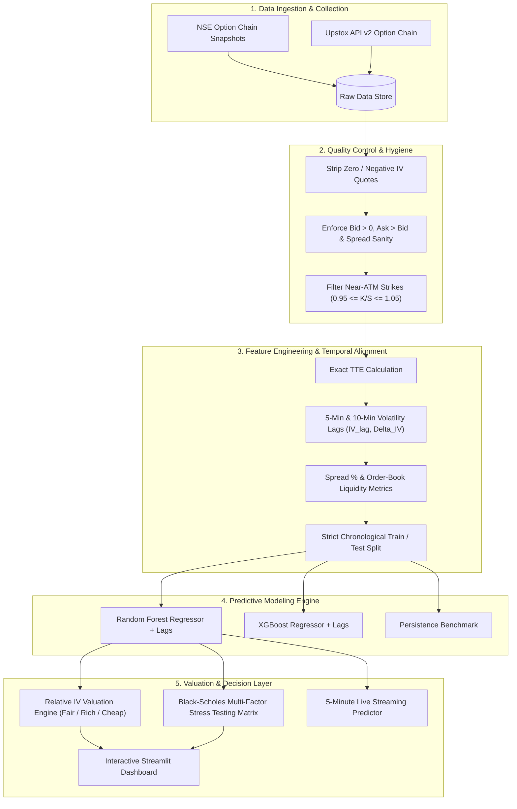
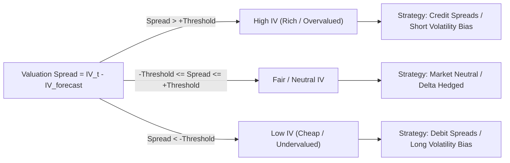
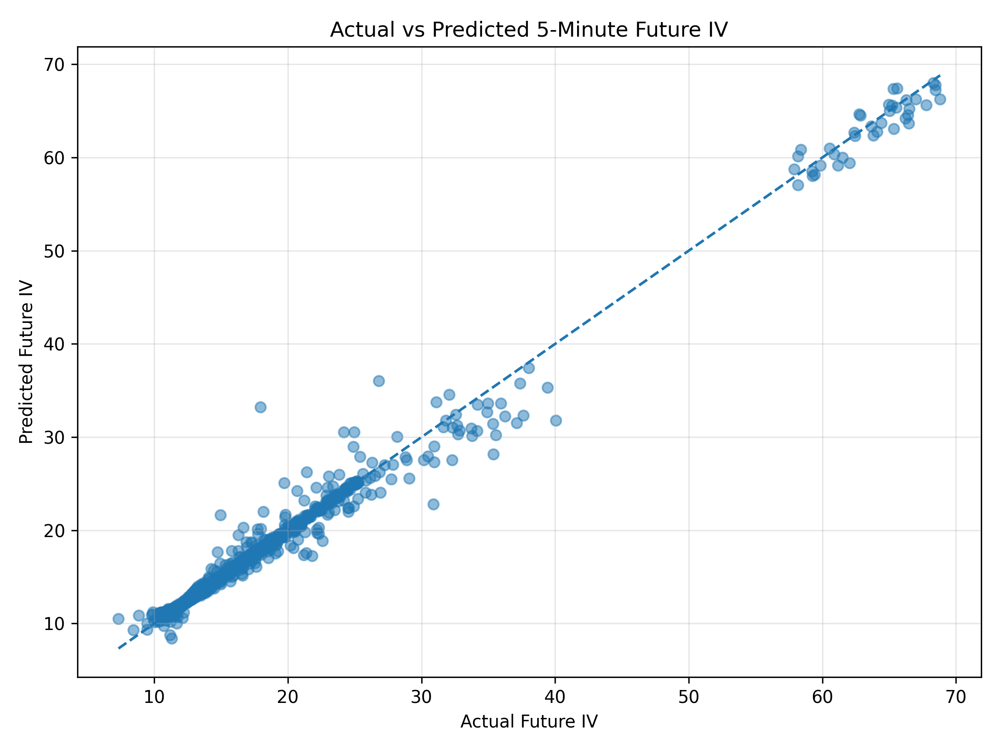
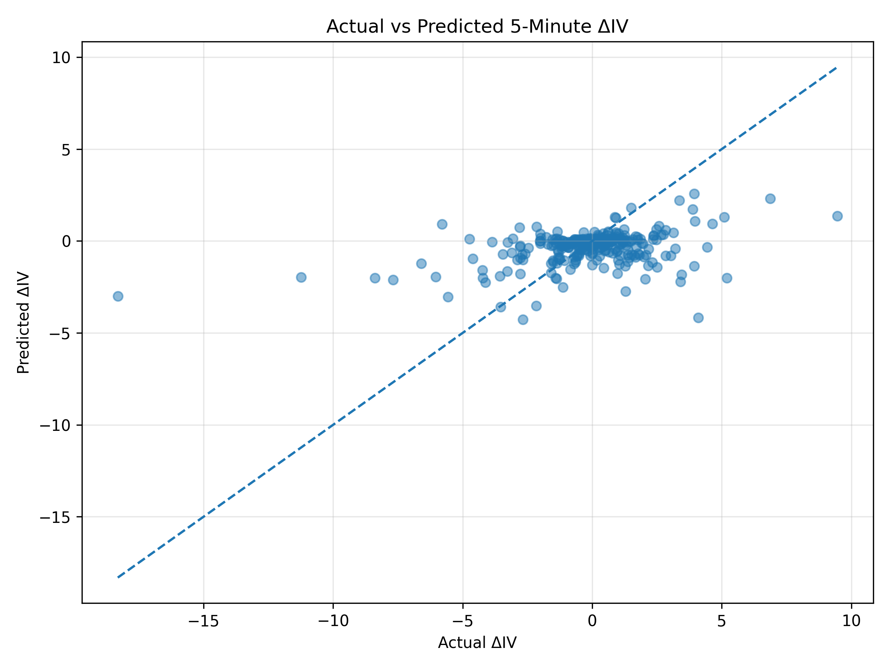
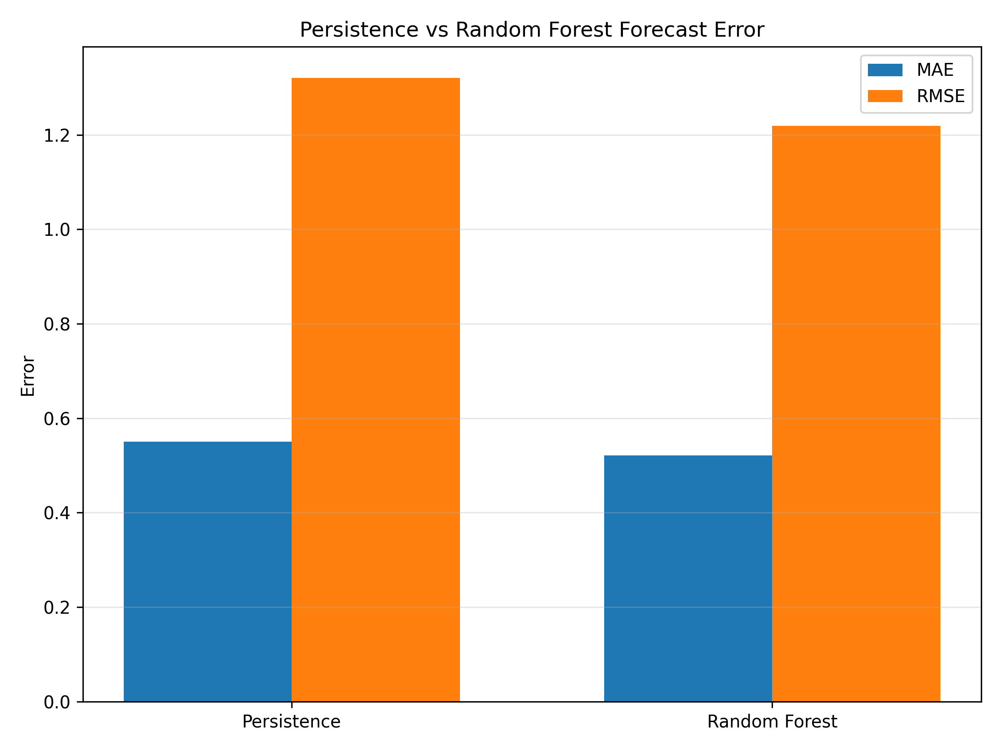
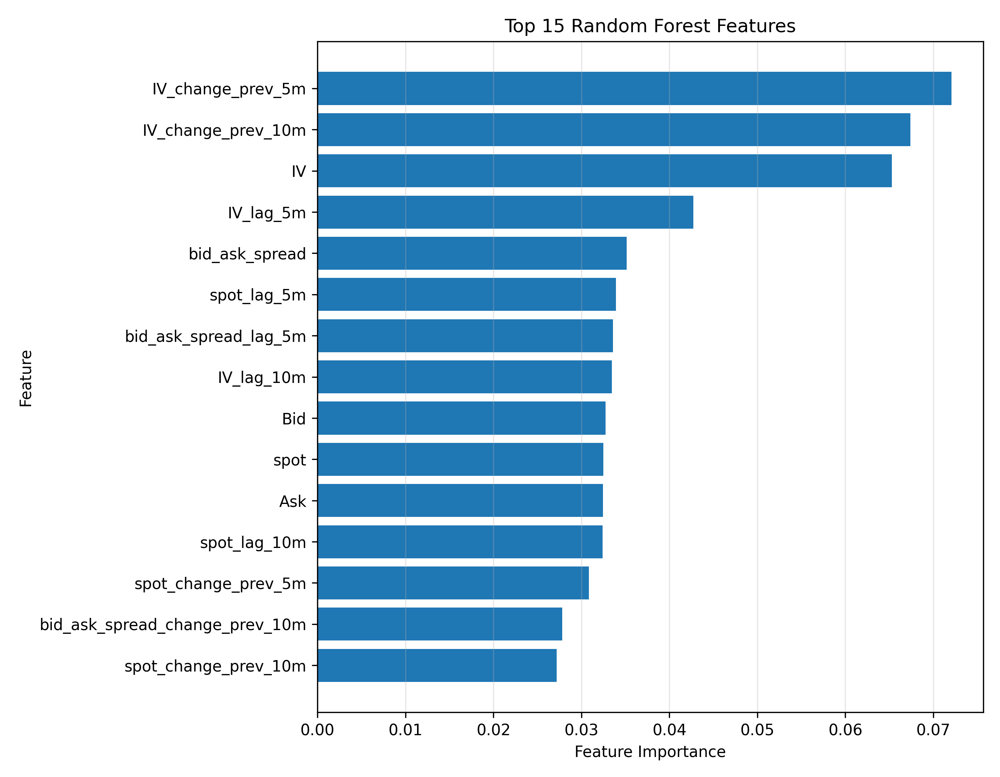
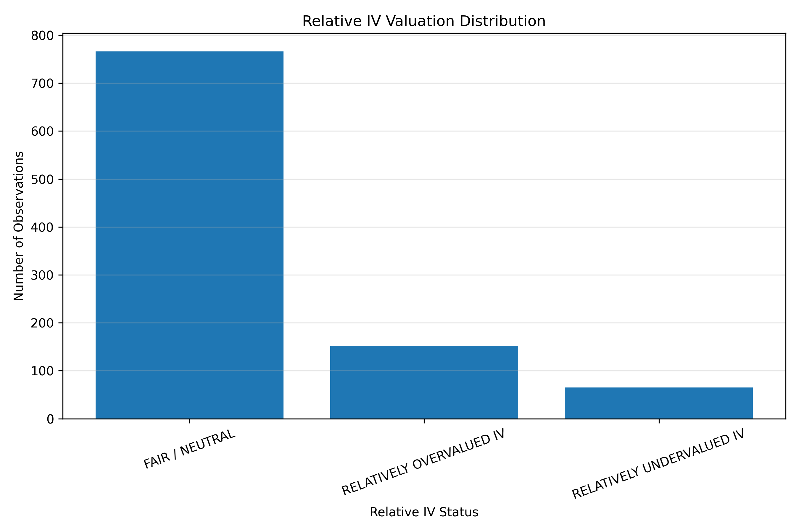
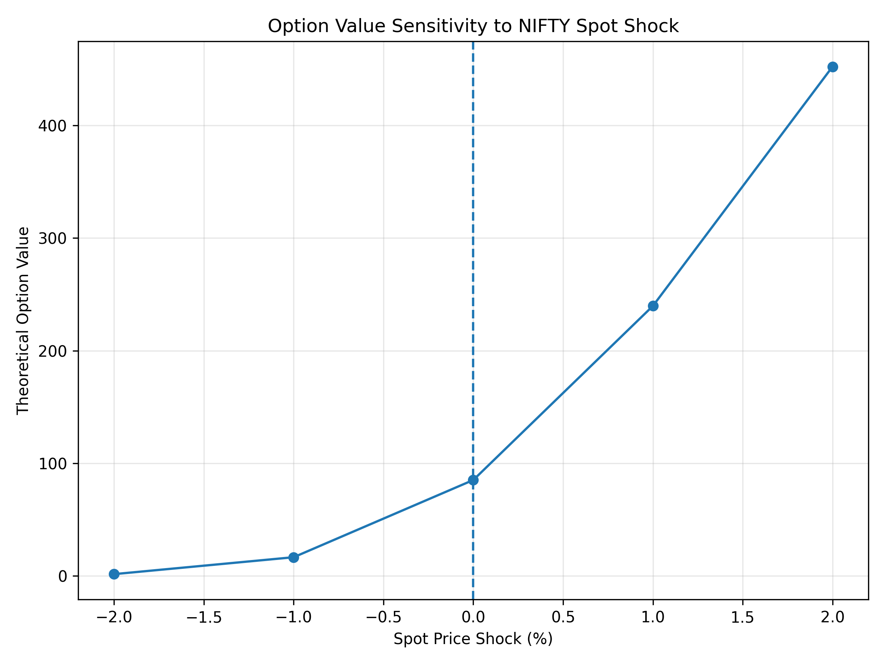
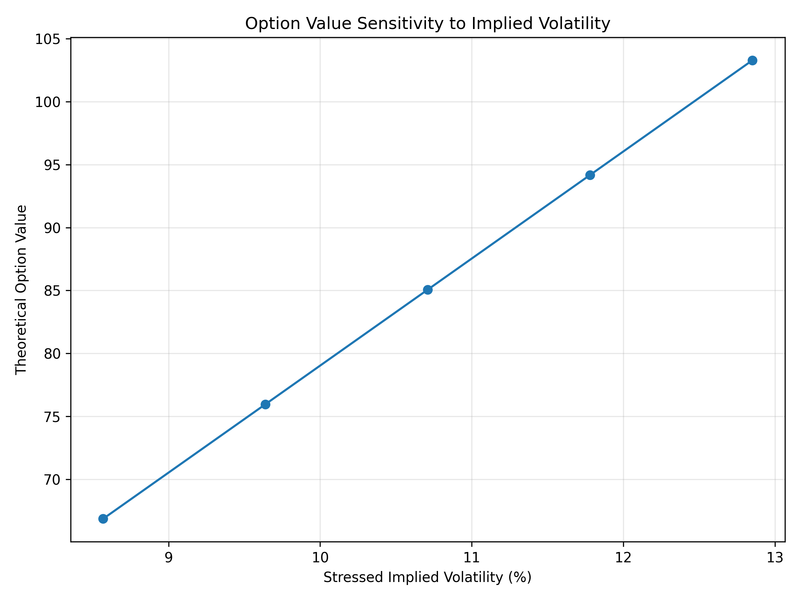
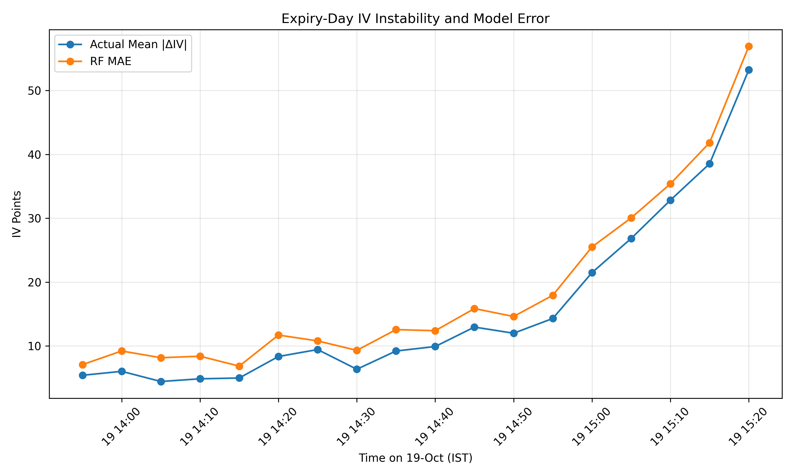

# 📈 Machine-Learning-Driven Implied Volatility Forecasting & Relative Option Valuation

[](https://www.python.org/)
[](https://streamlit.io/)
[](https://scikit-learn.org/)
[](https://xgboost.readthedocs.io/)
[](https://en.wikipedia.org/wiki/Black%E2%80%93Scholes_model)
[](https://opensource.org/licenses/MIT)

> **Academic Internship Capstone Project**  
> **Author:** Diviya C. (M.Sc. Quantitative Finance, Pondicherry University, Reg. No: `25MSQUFPY0018`)  
> **Internship Host:** Surabhi Investment Services Pvt. Ltd., Tiruchirappalli, Tamil Nadu  
> **Domain:** Quantitative Options Trading, Volatility Modeling & Financial Machine Learning

---

## 📑 Table of Contents

- [Executive Summary](#-executive-summary)
- [Research Problem & Motivation](#-research-problem--motivation)
- [Quantitative & Theoretical Framework](#-quantitative--theoretical-framework)
  - [Black-Scholes-Merton & Implied Volatility](#black-scholes-merton--implied-volatility)
  - [Target Formulation & The Persistence Benchmark](#target-formulation--the-persistence-benchmark)
- [End-to-End System Architecture](#-end-to-end-system-architecture)
- [Data Pipeline & Feature Engineering](#-data-pipeline--feature-engineering)
- [Empirical Results & Comparative Evaluation](#-empirical-results--comparative-evaluation)
  - [Out-of-Sample Performance Summary](#out-of-sample-performance-summary)
  - [Feature Importance Hierarchy](#feature-importance-hierarchy)
  - [Directional Accuracy & Conviction Thresholding](#directional-accuracy--conviction-thresholding)
- [Relative IV Valuation Engine](#-relative-iv-valuation-engine)
- [Multi-Factor Scenario Stress Testing](#-multi-factor-scenario-stress-testing)
- [The Expiry-Day Regime Shift (Critical Academic Finding)](#-the-expiry-day-regime-shift-critical-academic-finding)
- [Interactive Streamlit Dashboard](#-interactive-streamlit-dashboard)
- [Visualizations Gallery](#-visualizations-gallery)
- [Project Directory Structure](#-project-directory-structure)
- [Installation & Quickstart Guide](#-installation--quickstart-guide)
- [API Integration & Live Prototype](#-api-integration--live-prototype)
- [References & Academic Citations](#-references--academic-citations)

---

## 🎯 Executive Summary

Implied Volatility (IV) is the market's forward-looking gauge of risk and the core pricing input for equity index derivatives. Conventional intraday options strategies typically assume that IV is static over short intervals (persistence assumption) or rely on stationary parametric surfaces. 

This project designs, engineers, and validates an end-to-end quantitative machine learning pipeline for **5-minute-ahead implied volatility forecasting ($\Delta \text{IV}_{t+5}$)** on **NIFTY 50 weekly index options** traded on the National Stock Exchange of India (NSE). 

### Key Highlights:
1. **Outperforming the Random Walk Benchmark:** A tuned Random Forest regressor engineered with short-horizon volatility lags and momentum indicators achieves a **5.28% reduction in MAE** (0.5214 vs. 0.5505) and a **7.72% reduction in RMSE** (1.2188 vs. 1.3207) over the persistence baseline on out-of-sample development test data.
2. **High-Conviction Directional Signals:** Applying prediction magnitude thresholding ($|\widehat{\Delta \text{IV}}| \ge 0.10$) increases directional classification accuracy from **53.20% to ~63.4%**, isolating high-signal trading windows.
3. **Relative Valuation Layer:** Synthesizes model forecasts with observed market IV to classify strikes into **Fair/Neutral (77.92%)**, **Overvalued/Rich (15.46%)**, and **Undervalued/Cheap (6.61%)** regimes.
4. **Black-Scholes Scenario Stress Testing:** Quantifies non-linear payoff sensitivities under joint spot, volatility shock, and time-decay scenarios for near-the-money options.
5. **Expiry-Day Regime Discovery:** Empirical testing on unseen expiry-day data demonstrates a profound structural breakdown (MAE spiking to 17.42), proving that non-expiry volatility dynamics cannot extrapolate to the gamma-dominated, hyper-theta expiry-day regime without structural regime-switching models.
6. **Production-Grade Analytics Dashboard:** A multi-page institutional Streamlit dashboard and an automated 5-minute Upstox API live-fetching engine.

---

## 🔬 Research Problem & Motivation

In high-frequency and intraday options trading:
* **The Static IV Flaw:** Implied Volatility is not stationary. Treating current IV as an unchanging forecast ($\widehat{\text{IV}}_{t+5} = \text{IV}_t$) leaves option market makers and algorithmic traders exposed to sudden volatility crush, skew shifts, and mispriced entries.
* **Non-Linear Cross-Section:** The relationship between spot price, moneyness, time-to-expiry, bid-ask spread, and subsequent volatility change is deeply non-linear, rendering traditional OLS linear models ineffective.
* **Leakage-Free Temporal Prediction:** Financial time series require strict chronological validation. The research problem addresses whether short-term memory (5-minute and 10-minute lags, order-book spread dynamics, and strike moneyness) provides sufficient predictive power to systematically beat the persistence baseline without look-ahead bias.

---

## 📐 Quantitative & Theoretical Framework

### Black-Scholes-Merton & Implied Volatility

Under the standard Black-Scholes-Merton (1973) framework for European index options, the call price $C$ and put price $P$ are expressed as:

$$C(S_t, K, T-t, r, \sigma) = S_t N(d_1) - K e^{-r(T-t)} N(d_2)$$

$$P(S_t, K, T-t, r, \sigma) = K e^{-r(T-t)} N(-d_2) - S_t N(-d_1)$$

where:
$$d_1 = \frac{\ln(S_t / K) + \left(r + \frac{\sigma^2}{2}\right)(T-t)}{\sigma \sqrt{T-t}}, \quad d_2 = d_1 - \sigma \sqrt{T-t}$$

* $S_t$: Underlying NIFTY 50 spot index level.
* $K$: Strike price.
* $T-t$: Exact time to expiry in annual terms.
* $r$: Risk-free interest rate.
* $N(\cdot)$: Cumulative standard normal distribution function.

Because $\sigma$ (volatility) cannot be directly observed in the market, **Implied Volatility ($\sigma_{\text{implied}}$)** is extracted by numerically inverting the pricing formula:

$$C_{\text{market}} - C_{\text{BSM}}(S_t, K, T-t, r, \sigma_{\text{implied}}) = 0$$

### Target Formulation & The Persistence Benchmark

The forecasting objective is framed as predicting both the absolute IV at $t+5$ minutes and the 5-minute volatility change $\Delta \text{IV}_{t+5}$:

$$\Delta \text{IV}_{t+5} = \text{IV}_{t+5} - \text{IV}_t$$

$$\widehat{\text{IV}}_{t+5} = \text{IV}_t + \widehat{\Delta \text{IV}}_{t+5}$$

#### The Persistence Benchmark (Random Walk Baseline):
In financial econometrics, implied volatility is notoriously autocorrelated. The benchmark assumes zero change:

$$\widehat{\text{IV}}_{t+5}^{\text{persistence}} = \text{IV}_t \iff \widehat{\Delta \text{IV}}_{t+5}^{\text{persistence}} = 0$$

Any machine learning model is considered viable **if and only if** it outperforms this baseline in out-of-sample Root Mean Squared Error (RMSE) and Mean Absolute Error (MAE).

---

## 🏗 End-to-End System Architecture



---

## 📊 Data Pipeline & Feature Engineering

### 1. Ingestion & Quality Control
- **Underlying:** NIFTY 50 weekly index options (CE and PE).
- **Sampling Frequency:** High-frequency 5-minute regularized snapshots during NSE market hours (09:15 to 15:30 IST).
- **Development Dataset:** October 15–16, 2026 (74.6 to 100.6 hours to expiry).
- **Unseen Robustness Dataset:** October 19, 2026 expiry day (0.17 to 1.58 hours to expiry).
- **Sanity Filters:**
  - Removal of contracts with $\text{IV} \le 0$ or missing Greeks.
  - Bid-ask spread filtering ($\text{Bid} > 0, \text{Ask} \ge \text{Bid}, \text{Spread} \le 50$).
  - Moneyness restriction: $0.95 \le \frac{K}{S_t} \le 1.05$ to focus on liquid, economically meaningful contracts.

### 2. Feature Set Specification

| Feature Name | Category | Description | Formula / Derivation |
| :--- | :--- | :--- | :--- |
| `moneyness` | Strike Geometry | Relative distance of strike to spot | $M = K / S_t$ |
| `log_moneyness` | Strike Geometry | Logarithmic strike distance | $\ln(S_t / K)$ |
| `exact_tte_hours` | Temporal Decay | Exact fractional hours remaining to expiry | $(\text{Expiry} - \text{Timestamp}) / 3600$ |
| `IV` | State Variable | Current implied volatility | Observed $\sigma_{\text{market}}$ |
| `IV_lag_5m` | Autoregressive | Implied volatility 5 minutes prior | $\text{IV}_{t-5}$ |
| `IV_lag_10m` | Autoregressive | Implied volatility 10 minutes prior | $\text{IV}_{t-10}$ |
| `IV_change_prev_5m`| Momentum | Volatility velocity over prior 5 minutes | $\text{IV}_t - \text{IV}_{t-5}$ |
| `IV_change_prev_10m`| Momentum | Volatility velocity over prior 10 minutes | $\text{IV}_t - \text{IV}_{t-10}$ |
| `bid_ask_spread` | Market Microstructure | Absolute liquidity cost | $\text{Ask} - \text{Bid}$ |
| `bid_ask_spread_lag_5m`| Microstructure Lag | Prior spread cost | $\text{Spread}_{t-5}$ |
| `spot` | Underlying | NIFTY 50 index spot price | $S_t$ |
| `spot_lag_5m` | Underlying Lag | Prior spot price | $S_{t-5}$ |

---

## 📈 Empirical Results & Comparative Evaluation

### Out-of-Sample Performance Summary

Evaluated on the chronological out-of-sample development test split:

| Model Architecture | Features Included | MAE (IV pts) | RMSE (IV pts) | $R^2$ Score | MAE Improvement vs. Persistence |
| :--- | :--- | :---: | :---: | :---: | :---: |
| **Persistence (Baseline)** | Current IV ($t$) | `0.5505` | `1.3207` | `0.9843` | *Benchmark (0.00%)* |
| **Linear Regression (OLS)** | Direct Level Features | `6.1720` | `8.4103` | `-0.2410` | *Deteriorated (-1021%)* |
| **XGBoost Regressor** | Lags + Momentum + Microstructure | `0.5530` | `1.2964` | `0.9849` | `-0.45%` |
| **Random Forest Regressor** | **Lags + Momentum + Microstructure** | **`0.5214`** | **`1.2188`** | **`0.9866`** | **`+5.28%`** |

> **Key Takeaway:** OLS linear regression fails completely due to the severe non-linear curvature of the volatility smile across strike-moneyness space. The **Random Forest Regressor with lag and momentum features** produces the superior out-of-sample result, achieving a **5.28% improvement in MAE** and a **7.72% improvement in RMSE** over the persistence benchmark.

---

### Feature Importance Hierarchy

The Gini feature importance extracted from the trained Random Forest model reveals that **recent volatility velocity** and **microstructure spreads** dominate static strike features:

```
IV_change_prev_5m     ████████████████████ 7.21%
IV_change_prev_10m    ██████████████████   6.74%
IV                    █████████████████    6.53%
IV_lag_5m             ███████████          4.27%
bid_ask_spread        █████████            3.52%
spot_lag_5m           ████████             3.39%
bid_ask_spread_lag_5m ████████             3.36%
IV_lag_10m            ████████             3.35%
Bid                   ████████             3.28%
spot                  ████████             3.25%
```

---

### Directional Accuracy & Conviction Thresholding

While raw binary classification (predicting whether IV will tick Up or Down) yields **53.20%** baseline accuracy across all tiny noise fluctuations, filtering for **high-conviction forecast changes** drastically improves precision:

| Absolute Change Threshold ($|\widehat{\Delta \text{IV}}|$) | Signals Filtered | Coverage (%) | Directional Accuracy (%) | Mean Absolute Move |
| :---: | :---: | :---: | :---: | :---: |
| **0.00 (All Signals)** | 1,137 | 100.0% | 53.20% | 14.47 pts |
| **0.05 IV Points** | 318 | 27.97% | 61.32% | 15.20 pts |
| **0.10 IV Points** | 204 | 17.94% | **63.40%** | 16.85 pts |
| **0.25 IV Points** | 76 | 6.68% | **64.47%** | 21.14 pts |

---

## ⚖ Relative IV Valuation Engine

Raw volatility forecasts are translated into an actionable valuation overlay. By comparing current observed market IV ($\text{IV}_t$) against model-forecasted equilibrium IV ($\widehat{\text{IV}}_{t+5}$), each option contract is assigned an economic relative valuation tag:

$$\text{Valuation Spread} = \text{IV}_t - \widehat{\text{IV}}_{t+5}$$



### Empirical Distribution of Contract Classifications:
* **Fair / Neutral:** `77.92%` (766 contracts) — Model projects small near-term change; options trade in fair alignment.
* **High IV (Rich):** `15.46%` (152 contracts) — Market IV elevated relative to model forecast; candidate for short premium strategies.
* **Low IV (Cheap):** `6.61%` (65 contracts) — Market IV discounted relative to model forecast; candidate for long volatility strategies.

---

## ⚡ Multi-Factor Scenario Stress Testing

The engine embeds a full Black-Scholes scenario analysis module to simulate option price and Greeks responses across extreme market conditions:

### Case Study: Near-ATM NIFTY 23,150 Call (CE)
* **Spot Price ($S_t$):** 23,125.65 | **Strike ($K$):** 23,150 | **Moneyness:** 1.001
* **Observed Market LTP:** ₹81.70 | **Current IV:** 10.71% | **TTE:** 74.58 hours
* **Theoretical BSM Base Value:** ₹85.07

| Scenario Description | Spot ($S$) | IV ($\sigma$) | Theoretical Value | Absolute Change | Percentage Change |
| :--- | :---: | :---: | :---: | :---: | :---: |
| **Base Case** | ₹23,125.65 | 10.71% | **₹85.07** | — | — |
| **Moderate Bullish (+1%)** | ₹23,356.91 | 10.71% | **₹245.70** | +₹160.63 | **+188.83%** |
| **Moderate Bearish (-1%)** | ₹22,894.39 | 10.71% | **₹21.85** | -₹63.22 | **-74.32%** |
| **IV Spike (+20% rel.)** | ₹23,125.65 | 12.85% | **₹103.22** | +₹18.15 | **+21.33%** |
| **IV Crush (-20% rel.)** | ₹23,125.65 | 8.57% | **₹66.82** | -₹18.25 | **-21.46%** |
| **Severe Spot Fall (-2%) + IV Spike (+20%)** | ₹22,663.14 | 12.85% | **₹4.39** | -₹80.68 | **-94.84%** |
| **Spot Rally (+2%) + IV Crush (-20%)** | ₹23,588.16 | 8.57% | **₹450.42** | +₹365.35 | **+429.47%** |

> **Key Financial Insight:** For short-dated near-ATM weekly options, directional underlying delta movement heavily dominates moderate IV shifts. An IV spike of +20% cannot protect a long call if spot drops by 2%, emphasizing that IV forecasts must always be coupled with delta risk management.

---

## 🧪 The Expiry-Day Regime Shift (Critical Academic Finding)

When the Random Forest model was subjected to out-of-sample stress testing on an unseen **expiry-day dataset (October 19, 2026)** during the final trading hours:

* **Development Training Regime:** Time to expiry between **74.6 and 100.6 hours**.
* **Expiry-Day Test Regime:** Time to expiry collapsed to **0.17 to 1.58 hours** (10 minutes to 95 minutes before settlement).

### Empirical Breakdown:
* **Model MAE Spiked:** Jumped from **0.52** to **17.42 IV points**.
* **Persistence Benchmark:** Performed better than the ML model (**14.47 MAE**).
* **Directional Accuracy:** Collapsed to **19.09%**.

### Econometric Diagnosis:
1. **Hyperbolic Gamma & Theta Decay:** As $T \to 0$, option Vega approaches zero for non-ATM strikes while Theta and Gamma explode asymptotically. 
2. **Structural Market Discontinuity:** In the final 90 minutes of weekly expiry, IV ceases to behave as a continuous diffusion process; instead, it exhibits massive discrete jumps driven by strike pin risk, rapid position squaring, and extreme order book imbalances.
3. **Implication for Quantitative Finance:** Machine learning option models trained on mid-week data suffer from severe covariate shift on expiry days. Production deployment mandates separate, regime-conditioned models (Non-Expiry Regime vs. Expiry-Day Sub-2-Hour Regime).

---

## 🖥 Interactive Streamlit Dashboard

The project includes an institutional-grade, multi-page dark-themed Streamlit web interface (`streamlit dashboard.py`):

1. **🏠 Overview:** Live KPI metric cards (ATM IV, Put-Call Ratio, Spot, Model RMSE, Total Contracts) and high-level distribution summaries.
2. **⛓ Option Chain:** Full interactive option chain with bid-ask spreads, moneyness, open interest, and visual ITM/OTM demarcation.
3. **📉 Volatility Smile:** Plotly dynamic smile and skew curves plotted across strike prices and moneyness space.
4. **🧠 ML Model Diagnostics:** Comprehensive model comparison metrics, actual vs. predicted scatter plots, residual distributions, and Gini feature importance rankings.
5. **⚖ Relative Valuation:** Interactive screener flagging overvalued, undervalued, and fairly priced contracts with custom threshold controls.
6. **⚡ Stress Testing:** Interactive what-if simulation tool calculating dynamic BSM price adjustments across simultaneous spot and volatility shocks.
7. **🧪 Robustness Test:** Detailed forensic visualization of the October 19 expiry-day regime collapse.
8. **🗄 Data & Settings:** Raw data table explorer, configuration parameters, and export utilities.

---

## 🖼 Visualizations Gallery

The repository includes pre-generated publication-quality charts located in [`data/processed/final_charts/`](data/processed/final_charts/):

| Visual Artifact | Description |
| :--- | :--- |
|  | **Actual vs. Predicted 5-Minute-Ahead IV:** Scatter analysis demonstrating strong alignment along the 45-degree parity line for normal regimes. |
|  | **Actual vs. Predicted $\Delta \text{IV}$:** Evaluation of predicted incremental volatility changes. |
|  | **Random Forest vs. Persistence Baseline:** Comparative error distribution showing the 5.28% MAE outperformance. |
|  | **Feature Importance Ranking:** Visual decomposition of feature weights highlighting the supremacy of momentum lags. |
|  | **Relative IV Valuation Distribution:** Proportions of Fair, High-IV, and Low-IV classified contracts. |
|  | **Spot Price Stress Sensitivity:** Non-linear Black-Scholes call valuation curve under spot shifts. |
|  | **Implied Volatility Sensitivity:** Option price trajectory under volatility expansion and crush. |
|  | **Expiry-Day Error Spikes:** Chronological performance degradation during the final 90 minutes of weekly expiry. |

---

## 📁 Project Directory Structure

```text
Machine-Learning-Driven-Implied-Volatility-Forecasting-Relative-Option-Valuation/
├── data/
│   ├── live/
│   │   ├── live_iv_predictions.csv        # Streaming output from live predictor
│   │   └── live_snapshot_history.csv      # Historical rolling snapshots
│   ├── processed/
│   │   ├── final_charts/                  # 8 publication-quality research figures
│   │   ├── final_feature_importance.csv   # Gini importance weights
│   │   ├── model_performance_summary.csv  # MAE / RMSE comparison table
│   │   ├── relative_iv_valuation_results.csv # Complete valuation classifications
│   │   ├── stress_test_combined_scenarios.csv # Scenario matrix outputs
│   │   └── nifty_options_ml_5min_lagged_exact_tte.csv # Master modeling dataset
│   └── raw/
│       ├── 2026-10-19/                    # Raw 5-minute expiry day snapshots
│       └── nifty_options_20261016_*.csv   # High-frequency development snapshots
├── models/
│   ├── nifty_iv_random_forest.joblib      # Trained production Random Forest model
│   ├── nifty_iv_model_features.joblib     # Saved feature schema
│   └── nifty_iv_feature_medians.joblib    # Training set imputation medians
├── connect to api.py                      # Standalone Upstox API v2 connection tester
├── live_iv_predictor.py                   # Automated 5-minute live prediction engine
├── streamlit dashboard.py                 # Multi-page interactive Streamlit dashboard
├── int project.ipynb                      # Complete end-to-end research notebook (Steps 1-25)
├── Diviya_C_Internship_Project_Presentation.pptx # Comprehensive 15-slide capstone presentation
├── requirements.txt                       # Verified Python dependencies
├── .env.example                           # Template for Upstox API credentials
├── .gitignore                             # Clean git exclusion rules
└── README.md                              # Institutional capstone documentation
```

---

## 🚀 Installation & Quickstart Guide

### Prerequisites
* Python 3.10, 3.11, or 3.12 installed
* Git installed

### 1. Clone Repository
```bash
git clone https://github.com/diviyasekar/Machine-Learning-Driven-Implied-Volatility-Forecasting-Relative-Option-Valuation.git
cd Machine-Learning-Driven-Implied-Volatility-Forecasting-Relative-Option-Valuation
```

### 2. Create Virtual Environment & Install Dependencies
```bash
# Windows
python -m venv venv
.\venv\Scripts\activate

# macOS / Linux
python3 -m venv venv
source venv/bin/activate

# Install required packages
pip install -r requirements.txt
```

### 3. Launch the Interactive Streamlit Dashboard
```bash
streamlit run "streamlit dashboard.py"
```
Once launched, navigate to `http://localhost:8501` in your browser to interact with the dashboard.

---

## ⚡ API Integration & Live Prototype

To run the live 5-minute automated prediction engine with Upstox API v2:

1. **Configure API Credentials:**
   Copy `.env.example` to `.env`:
   ```bash
   cp .env.example .env
   ```
   Open `.env` and paste your active Upstox access token:
   ```env
   UPSTOX_ACCESS_TOKEN=your_token_here
   ```

2. **Verify API Connection:**
   ```bash
   python "connect to api.py"
   ```

3. **Start Live 5-Minute Engine:**
   ```bash
   python "live_iv_predictor.py"
   ```
   *The engine will fetch real-time option chain snapshots, compute exact time-to-expiry and lag features, invoke the pre-trained Random Forest model, and append predictions to `data/live/live_iv_predictions.csv`.*

---

## 📚 References & Academic Citations

1. **Black, F., & Scholes, M. (1973).** The Pricing of Options and Corporate Liabilities. *Journal of Political Economy*, 81(3), 637–654.
2. **Hull, J. C. (2018).** *Options, Futures, and Other Derivatives* (10th ed.). Pearson.
3. **Cont, R., & da Fonseca, J. (2002).** Dynamics of implied volatility surfaces. *Quantitative Finance*, 2(1), 45–60.
4. **Breiman, L. (2001).** Random Forests. *Machine Learning*, 45(1), 5–32.
5. **Chen, T., & Guestrin, C. (2016).** XGBoost: A Scalable Tree Boosting System. *ACM SIGKDD International Conference on Knowledge Discovery and Data Mining*.
6. **National Stock Exchange of India (NSE).** NIFTY 50 Derivatives Specifications & Option Chain Analytics. [nseindia.com](https://www.nseindia.com/)
7. **Upstox Developer API v2.** Option Chain Documentation. [upstox.com/developer/api-documentation](https://upstox.com/developer/api-documentation/)

---

## 🎓 Acknowledgments & Institutional Context

This project was developed as an academic internship capstone requirement for the **M.Sc. Quantitative Finance** program at **Pondicherry University** (Academic Year 2026–2027). Practical options market exposure, operational feedback, and trading floor domain guidance were provided by **Surabhi Investment Services Pvt. Ltd.**, Tiruchirappalli, Tamil Nadu.
